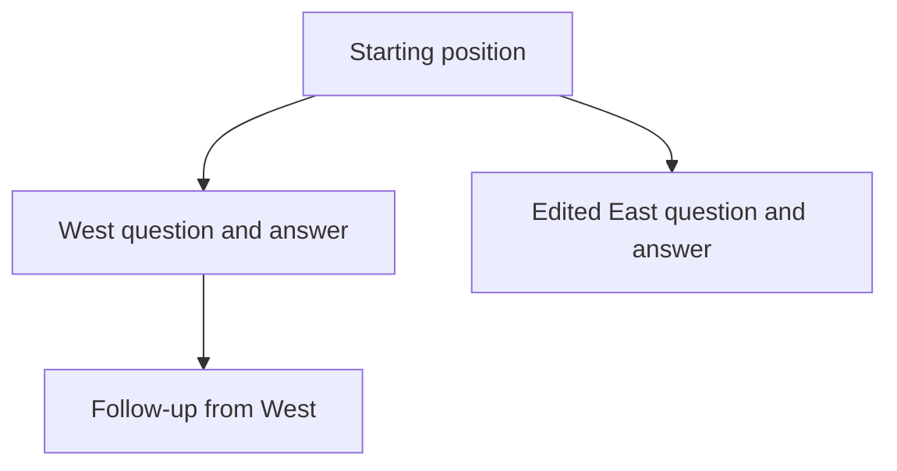
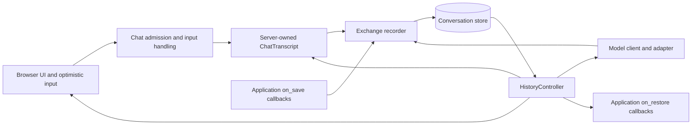
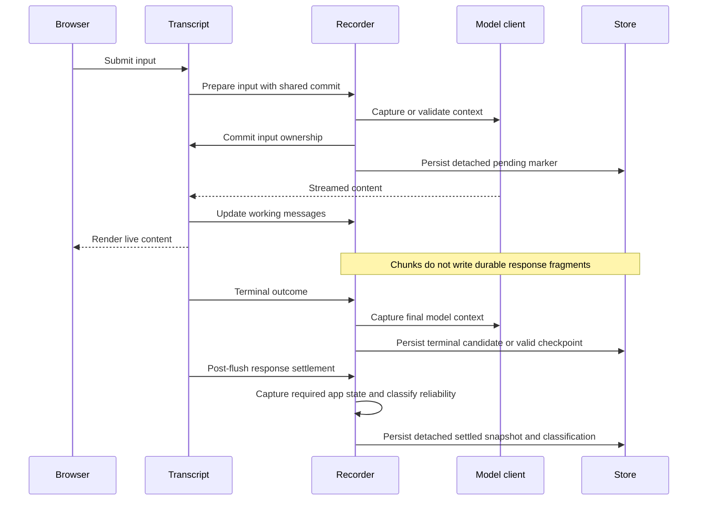

# Exchange-tree history

This document explains the Python/JavaScript exchange-tree history foundation and the principles behind it. It is an architectural reference for developers and future agents, not an API tutorial or a record of review sessions. The source remains authoritative for mechanism details.

**Scope:** the current exchange-tree implementation uses record schema version 2. The R implementation has not yet been ported to this foundation; shared fixtures and frontend infrastructure do not establish R behavioral parity. For message rendering and HTML trust boundaries, see [Content Rendering](content-rendering.md). For upgrade procedures, see the [history migration guide](../pkg-py/docs/history-migration.qmd).

## Mental model: a saved position is more than chat bubbles

A conversation has three related representations:

| Representation | What it contains | Authority |
|---|---|---|
| Displayed conversation | Accepted user inputs and server-produced message content, including structured blocks and attachments | The server-owned transcript and captured messages |
| Model context | Provider/client turns, tool results, system prompt, and context that may not appear as bubbles | The attached model client, accessed through its adapter |
| Application state | Values such as the selected dataset, filter, tab, or model selector | The app author's `on_save` and `on_restore` callbacks |

There is no general one-to-one mapping between displayed messages and model turns. A tool loop can produce several turns; programmatic messages can exist without an accepted input; app code can compact model context without changing the displayed answer. History must not reconstruct provider context by guessing from roles or bubble order.

An **exchange** is the ownership unit for an optional accepted input and its captured content. A **position** is a node on a conversation path. A **checkpoint** is a position whose required state capture succeeded and can be selected as a coherent destination. These terms are deliberately not interchangeable: content can exist without a reliable checkpoint.

Editing or retrying creates an alternative path rather than deleting the previous exchange. For example:

The selected position determines the displayed path and the state entries to apply. Each parent remembers a selected child, so returning to a branch can recover its remembered coherent destination rather than arbitrarily choosing a sibling.

For a concrete example, suppose the app starts with a region filter set to All and its model client contains seeded context. The first question asks for West; a tool selects West while answering. The starting checkpoint records All and the pre-question model context. The completed West position records the answer's model context and West app values.

Editing that first question to East starts from the saved starting position. `on_restore` lets the app return its filter to All before the replacement provider work; the East tool call then changes it to East. West remains a separate branch. Browsing back to West restores West values without capturing the stale East filter over them. The important unit is the selected position, not whichever filter happens to be live when the user clicks a history control.

## Architecture and ownership

- **`ChatTranscript` owns committed display content.** It assigns exchange identity and associates messages/streams with that identity. Browser echoes and optimistic rows are not the persisted source of truth.
- **`_ExchangeRecorder` owns the working tree and capture boundaries.** Its lock serializes record mutations and store writes. It observes accepted inputs, message commits, and stream lifecycle events.
- **`HistoryController` owns position changes.** It selects/preflights paths, restores or rewinds state, replays display content, invokes app restoration, and publishes history metadata.
- **`TurnsAdapter` mediates model state.** Provider-specific state is not made portable merely because its outer record uses JSON.
- **The browser owns presentation and pending interaction state.** `HistoryStore` tracks readiness, busy/read-only state, and correlated transitions. It does not decide that a server checkpoint is valid.

The public app-state hooks are intentionally small. The internal capture/restore/rewind hook registry organizes versioned state namespaces; it is not an invitation to infer state from display messages or introduce a second ownership ledger.

## Tree and state representation

`ConversationRecordV2` contains conversation metadata, a node map, and `active_leaf`. `root_id` is derived from the unique parentless node; callers must not assume a particular root identifier. An `ExchangeNode` contains parent/child links, remembered `selected_child`, optional `input`, captured `messages`, state entries, provider outcome, and checkpoint classification.

Inputless nodes are real: explicit programmatic content or independent responses can occupy positions without a user input. An independent assistant response opens an inputless position rather than reopening and overwriting an already-completed exchange.

### Three independent questions

1. **What happened to the response?** `status` is `pending`, `ok`, `error`, or `cancelled`.
2. **Can this position serve as a checkpoint?** `checkpoint` is `candidate`, `valid`, or `invalid`.
3. **Did a detached snapshot reach the store?** This depends on successful persistence, not just either field above.

A handled provider error or ordinary cancellation can still yield a valid checkpoint. Conversely, an answer can finish successfully but fail required model/app capture. A valid in-memory checkpoint is not proof that a store write succeeded.

Older schema-2 records may omit the checkpoint field. Compatibility derives terminal positions as valid and pending positions as candidates, with an empty starting-root exception. That is a legacy assumption, not retrospective detection of old capture failures. New writes classify checkpoints explicitly.

### Versioned state namespaces

`StateEntry` has `kind`, `version`, `mode`, and JSON `data`.

| Namespace | Current capture strategy | Restore meaning |
|---|---|---|
| `shinychat:turns` | Full model snapshots for new coherent captures | Materialize compatible client context; legacy delta entries remain readable |
| `shinychat:system_prompt` | Sparse snapshots when the adapter supports a prompt | Apply the latest effective recorded prompt separately from turns |
| `shinychat:values` | Sparse JSON objects | Resolve values at the selected position and pass a detached object to `on_restore` |

Sparse does not mean fragile inheritance. Before changing a shared parent's prompt/values, children that inherit its old value are pinned to that previous value. Otherwise, recapturing one parent could silently rewrite what an older branch restores. Comparisons use canonical JSON, distinguishing booleans from numbers and ignoring object-key order. An explicit empty values object clears an older object; absence of any values entry resolves to `{}`.

New model snapshots avoid turn-delta baselines and reconciliation of rewritten prefixes. Legacy delta children are protected before their shared prefix changes. Repeating full prefixes can grow total storage quadratically with conversation length; that trade-off is accepted rather than hidden behind inference machinery. The configurable history storage budget defaults to 100 MB.

## Capture and persistence lifecycle

### First input defines the starting condition

On the ordinary user-driven path, first accepted input establishes the starting checkpoint: the actual model context and app values from that moment, before provider work. It does not freeze an earlier startup configuration.

The recorder stages the model/app pair on the root, invokes `on_save` once, and lets the new first exchange inherit those values. A successful recapture replaces an existing starting pair together; a failed automatic app capture must not replace only its model half. Failure retains previously recorded state or its absence—it cannot manufacture a successful starting snapshot.

The root is a structural node, not a guarantee that no record can exist before user input. Explicit programmatic content can create an inputless record, and compatibility/explicit-save paths can contain root state. That does not change the first-input starting-boundary rule; an actively streamed or otherwise ineligible root is not recaptured as a settled starting checkpoint.

### Input ownership commits together

`ChatTranscript.record_accepted_input_and_notify()` prepares a detached input and gives the recorder a synchronous commit callback. The recorder performs model capture/validation, opens the exchange, then commits transcript ownership before awaiting persistence/publication.

This distinguishes two failures:

- **Model capture fails before commit:** the input has not been accepted by either owner; normal rejection removes the matching optimistic UI row. A freshly created record is discarded.
- **Persistence fails after commit:** the accepted input already belongs to the transcript/tree. Treating it as an unaccepted message would lie about what happened.

For later input, a coherent predecessor captures model-only changes; an unresolved predecessor is validated without being promoted to a checkpoint. App values capture on the new exchange. New input invalidates superseded candidate positions along its path rather than pretending they settled successfully.

### Live output is not partial durability

Accepted inputs and some inputless stream starts can persist unresolved markers. Pending response fragments are removed from writable persisted snapshots; a pending root stream has its own write suppression. Therefore, “terminal-only” describes response durability, not a claim that no record write occurs before response completion.

At stream end, model state is captured alongside the terminal outcome. If app capture is required, the position remains a candidate until reactive settlement. App callbacks run after the stream task can expose its result, not inside a still-running stream task that denies ordinary reactive reads. Settlement makes the position valid or invalid. A complete non-streamed assistant append also captures model context rather than persisting display alone.

| Boundary | Model state | `on_save` values | Persistence/eligibility |
|---|---|---|---|
| First accepted input, eligible root | Staged with app state on root | Once, on root | New input becomes a pending position |
| Later accepted input | Capture coherent predecessor or validate unresolved context | On new exchange | No promotion of unresolved predecessor |
| Stream chunks | No checkpoint capture | No | Working memory only |
| Terminal stream / complete assistant append | Capture actual client context | Not inside stream task | Valid immediately without required app capture, otherwise candidate |
| Post-flush response settlement | Uses terminal model capture | Required app capture | Valid on success, invalid on capture failure |
| Explicit history save | Capture a coherent selected position | Strict capture; errors propagate | Does not settle an in-flight response |
| Coherent leave/rewind/disconnect | Model-only changes | No | Preserve latest context without rewriting app snapshots |
| Browse/load/replay | Apply saved state as appropriate | No | Selection/replay is not app capture |
| Rename/pointer update | No checkpoint capture | No | Persist metadata without recording unrelated live values |

Background retitling remains metadata-only. Disconnect flush runs before synchronous chat cleanup, publishes no client update, and does not turn an unfinished response into a completed checkpoint.

## Restoring and selecting positions

### Plan before mutation

State preflight validates the selected path, resolves compatible model context, and prepares hook execution before destructive state changes. A normal restore replays captured display content, applies recorded state, installs the record, then calls `on_restore` with the selected values. Replay suppresses capture callbacks: loading a conversation must not manufacture new responses or captures.

Display restore uses the recorded input and `CapturedMessage.as_stored_message()`, not guessed text reconstructed from provider turns. Content still goes through the normal server message/wire pipeline; no client-supplied message list becomes authoritative history.

Rewind differs from a full restore. It applies the retained parent before replacement provider work. System-prompt rewind compares recorded source/target entries, not the live prompt, so an app's restore override survives moving across an unchanged recorded prompt.

`ConversationRecordV2.checkpoint_leaf()` and `ConversationRecordV2.checkpoint_siblings()` select coherent destinations inside remembered branches. They are not arbitrary “nearest node” navigation that could silently promote an unfinished position.

### Read-only and source isolation are different

- **Unavailable model context:** compatible display can remain visible while input/edit/retry/regenerate are blocked. Display-only browsing does not apply model rewind hooks. Missing or incompatible provider context is not repaired by fabricating turns from the bubbles.
- **Ordinary app-restore failure:** callback dispatch stops at the first failure and viewing remains read-only. A resubmit preparation failure retains the original selected branch because its parent was not committed; browsing can retain the selected target. This is distinct from replacement rejection after a successful rewind.
- **Unresolved/invalid active source:** the restored viewer projects to paths ending at coherent checkpoints and becomes source-isolated. Pending fragments and invalid-only branches are not replayed as trusted conversational history. Structural ancestors needed for saved state can remain. The viewer must not overwrite or delete the source through pointer, metadata, rename, save, or shutdown paths.

Isolation belongs to that viewer, not to a global conversation fence. The original response task may continue after browser reload and later save its terminal checkpoint. Reload is not necessarily task cancellation or process death, and the detached new view does not automatically reconnect to that producer.

## User intent, failures, and explicit exits

A failed replacement does not mean the user wanted to return to the old successful branch. If an edit/retry rewinds successfully and replacement capture then fails, automatically replaying/selecting the original branch would erase the visible meaning of the attempted action. The design direction is to preserve the resulting state as faithfully as possible and make navigation back a separate user choice.

**Current gap:** the old branch remains stored, but there is no direct UI route to its hidden child from the rewound parent, and the rejected edit is removed rather than retained as a browsable failed attempt. Faithful failed-position navigation is a requirement, not an implemented guarantee. A failed position may deserve to be displayed even when it cannot be safely continued; these capabilities must stay separate.

New chat is an explicit user-directed exit. If its outgoing model-only capture fails, it warns the developer, preserves the existing saved conversation, and performs the normal client/display reset. It does not select an earlier branch or overwrite stored history with partial invalid state. Storage errors, reset failures, cancellation, and fatal errors still propagate. Reset cannot fix custom code that repeatedly produces invalid state or a permanently broken getter.

## Design principles and why the simpler choices matter

### 1. Model the domain before adding recovery machinery

Positions, exchanges, provider outcomes, checkpoint reliability, and successful persistence answer different questions. Keep them separate instead of inventing a status that conflates “shown,” “captured,” “saved,” and “resumable.” This separation supports viewing failures without promising safe continuation.

### 2. Use explicit ownership, not inferred correspondence

One server-owned transcript and explicit exchange identity connect input, content, and state. Shared input commit keeps the transcript and tree from disagreeing about acceptance. Avoid role-based turn grouping, positional matching, a second accepted-input ledger, or a queue used to paper over competing owners.

### 3. Prefer reconstructible snapshots to clever reconciliation

Capture the actual model client, with the system prompt handled separately. Full model snapshots replace delta-baseline repair and uncertain reconstruction after compaction. Sparse prompt/app entries are safe because their inheritance and child pinning are explicit. Accept and document storage cost rather than recovering apparent efficiency through inference.

### 4. Choose a durability contract that can be honored

Persist coherent terminal checkpoints rather than display-only partial progress. This removes the need to preserve a mid-stream coalescing writer and then build resumption/recovery around its mismatched state. An unfinished exchange may be lost in a hard crash; that is more honest than restoring a partial answer as usable model context.

### 5. Stage changes instead of stacking compensating patches

Capture on a staging tree and commit state dictionaries only after required hooks succeed. Detach payloads and store/restore records at the ownership boundary, including for custom stores that retain their arguments. Do not solve aliasing solely for one bundled backend or impose a hidden no-alias requirement on custom stores.

### 6. Let selected position determine app restoration

A single `on_restore(values)` follows load, switch, browsing, and retained-parent rewind. A separate public navigation hook would make authors choose whether their UI should follow the conversation. Capture at meaningful checkpoints, not merely when leaving a position: browsing with stale East app state must not overwrite a saved West branch. First input captures the actual starting condition once.

### 7. Preserve outcomes; make recovery an explicit choice

Do not automatically select the previous successful branch after a failed replacement. Record/display what can be represented faithfully, distinguish viewing from continuation, and provide explicit navigation/exit actions. New chat is a narrow discard boundary chosen by the user, not a general rollback engine. Unserializable state cannot be promised as fully restorable.

### 8. Make JSON representation a uniform storage contract

Memory storage is not permission to keep Python-only objects that file/custom storage cannot reproduce. Serializer-supported native values/keys normalize into detached JSON; authors own the restored representation. Keys that normalize to the same string keep the later entry. Unsupported objects and non-finite floats reject capture rather than silently becoming plausible state. Do not add a separate raw-key validator or collision policy that contradicts serialization.

### 9. Fail safely without pretending the state is coherent

Unavailable context or unhandled app restoration does not authorize degraded continuation. History notifications and replayed errors use safe explanations regardless of the app's general error-sanitization setting; details go to developer diagnostics. Live input/response errors retain their own `Chat.on_error` policy. Automatic app-capture failure warns and retains prior state; explicit save reports failure to its caller.

### 10. Bound concurrency and scope instead of adding speculative infrastructure

The recorder lock orders one working record's mutations and writes. It is not a cross-session lease, atomic compare-and-swap store, or shared-client provider journal. Supported operation uses serial mutation of one attached turn client; the display stream contract rejects competing foreground streams rather than queuing them. New checkpoints and isolation do not imply general multi-writer recovery.

When a proposed fix depends on an unnecessary premise, remove the premise/mechanism rather than add another guard, timer, epoch, retry ledger, or compatibility shim. Concern-based PR slices are for review; they need not become independently shippable runtimes through extra aliases. Verify the composed foundation and land it under the coordinated policy.

## Guarantees, costs, and remaining boundaries

- Coherent checkpoints preserve server-owned content and compatible captured context; they do not guarantee a write succeeded or fence arbitrary SDK mutations between terminal capture and app settlement.
- Pending markers can exist durably, but no partial-response durability/resumption promise follows from them.
- Full model prefixes trade simpler restoration for repeated storage. Store quota/eviction and migration backup procedures remain relevant.
- Model state is provider-specific; a shared outer schema does not establish cross-client or cross-language resumability.
- Live Retry metadata/icon behavior and the public screen-clear/history-record guard remain unfinished. Existing Retry after restore is not proof of immediate Retry after failure.
- Explicit original-branch and failed-attempt access are unfinished, as described above. Read-only display is not equivalent to retaining every failed intent.
- R parity is a later port and verification task. Source-level frontend sharing is not behavioral proof.

## Stable code reference map

Paths are relative to the repository root; use symbols rather than line numbers.

| Area | Path | Symbols / entry points |
|---|---|---|
| Public configuration and callback lifecycle | `pkg-py/src/shinychat/_history.py` | `HistoryOptions`, `ChatHistory.on_save`, `ChatHistory.on_restore`, `ChatHistory.enable` |
| Client-directed fresh conversation | `pkg-py/src/shinychat/_chat_client.py` | `ChatClient.new_chat` |
| Admission, rejected input, replay and cleanup | `pkg-py/src/shinychat/_chat.py` | `Chat._record_accepted_user_input_with_capture`, `Chat._handle_input_exception`, `Chat._destructive_history_mutation`, `Chat._end_session` |
| Server display ownership | `pkg-py/src/shinychat/_chat_transcript.py` | `ChatTranscript`, `record_accepted_input_and_notify`, stream lifecycle methods |
| Schema and selection | `pkg-py/src/shinychat/_history_types.py` | `ConversationRecordV2`, `ExchangeNode.checkpoint_state`, `CapturedMessage`, `StateEntry`, `ConversationRecordV2.checkpoint_leaf`, `ConversationRecordV2.checkpoint_siblings` |
| Capture and store boundary | `pkg-py/src/shinychat/_history_recorder.py` | `_ExchangeRecorder.accepted_input`, `capture_state_locked`, `stream_finished`, `response_settled`, `persist_record_locked`, `flush_pending` |
| Position transitions | `pkg-py/src/shinychat/_history_controller.py` | `HistoryController._prepare_exchange_restore`, `_restore_exchange_record_locked`, `_rewind_locked`, `new_chat`, `on_response` |
| State folding and plans | `pkg-py/src/shinychat/_history_plan.py` | `canonical_values`, `canonical_turns`, `sparse_snapshot_entry`, `resolve_path_values`, `materialize_restore_turns`, `preflight_state`, `run_plan` |
| Model adapter | `pkg-py/src/shinychat/_history_client.py` | `TurnsAdapter` |
| Persistence and namespace | `pkg-py/src/shinychat/_history_store.py` | `ConversationPartition`, `ConversationStore`, `InMemoryConversationStore`, `FileConversationStore` |
| Legacy conversion | `pkg-py/src/shinychat/_history_v1.py` | `import_v1_record` |
| Browser readiness and transitions | `js/src/chat/historyStore.ts` | `HistoryStore`, `isHistorySubmissionBlocked`, `acceptEditProjection`, `completeHistoryTransition` |
| Browser action routing / display | `js/src/chat/ChatApp.tsx`, `js/src/chat/state.ts`, `js/src/chat/ChatMessage.tsx` | history action handling, optimistic input/reducer state, edit/retry rendering |

Behavioral anchors live in `pkg-py/tests/test_history_controller.py`, `test_history_values.py`, `test_history_checkpoint_models.py`, `test_history_checkpoint_validity.py`, `test_history_interrupted.py`, `test_history_app_restore_lifecycle.py`, `test_history_new_chat_recovery.py`, and the history browser tests under `pkg-py/tests/playwright/chat/`. They distinguish captured state, persisted state, eligible navigation, restored display, and live client state instead of treating a happy-path transcript as proof of all five.
