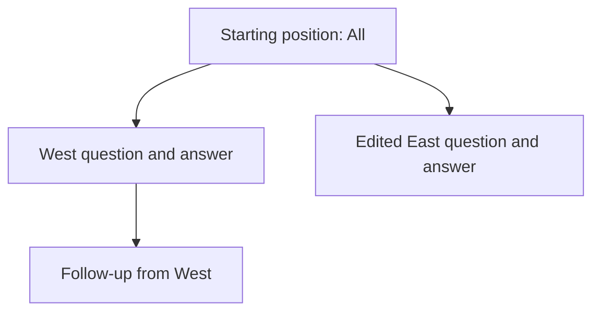

# Exchange-tree history

This is the design reference for exchange-tree conversation history: the domain model, lifecycle, and rules that should remain consistent across Python and R. It explains the shape of the solution rather than every implementation mechanism. Use the [implementation map](#implementation-map) for source-level detail and the [port contract](#port-contract) when extending the foundation to R.

**Implementation status:** Python and the shared JavaScript frontend implement this foundation; R has not yet been ported. The shared design below describes the implemented Python behavior and the target for the R port, not existing R parity. Record schema version is 2. Capture/restore callback roles are called `on_save`/`on_restore` here; language-specific API signatures belong in package documentation.

For rendering and HTML trust boundaries, see [Content Rendering](content-rendering.md). For Python upgrade procedures, see the [history migration guide](../pkg-py/docs/history-migration.qmd).

## Mental model

History preserves three independent facts about a conversation:

| Fact | Authority | Examples |
|---|---|---|
| Display content | Server-owned transcript and captured messages | Accepted input, UI-only appends, structured blocks, attachments |
| Model context | Attached model client, through an adapter | Turns, tool results, system prompt, compacted context |
| Application state | App capture/restore callbacks | Selected dataset, filter, tab, model selector |

These facts are correlated when recorded, not reconciled afterward. A tool loop can produce several turns; UI-only content can have no turn; context compaction need not change the displayed answer. Display/model disagreement is allowed by design. History must not reconstruct either representation by guessing from roles or message counts.

An **exchange** owns an optional accepted input and its captured content. A **position** is a node on a conversation path. A **checkpoint** is a position eligible as a coherent saved-state destination. Having content, having a checkpoint, and having successfully persisted it are different things.

Suppose a tool changes the region filter while answering West. The starting position records All and the pre-question model context; the completed West position records West and its answer's context. Editing the first question to East restores the starting position before replacement work. West and its follow-up remain stored. Browsing back restores the remembered West destination's values, not the live East filter. The selected position determines restoration; navigating must not capture stale outgoing UI state over another branch.

## Record shape and ownership

A partition `(chat_id, scope)` holds multiple conversations. Each conversation has metadata, a node map, and `active_leaf`; there is no global exchange tree.

Each node has parent/child links, remembered `selected_child`, optional input, captured messages, versioned state entries, response outcome, and checkpoint classification. The root is the unique parentless node, not a hard-coded identifier.

- **`active_leaf` selects a root-to-position path.** Other branches remain stored but are not displayed.
- **`selected_child` remembers a choice at each parent.** Switching branches preserves the other branch's remembered descendants.
- **Checkpoint selection stays inside a chosen subtree.** It follows eligible remembered children, falls back to the newest eligible child when needed, and returns a valid destination or none. Sibling arrows offer subtrees with coherent destinations, not every raw node or an arbitrary nearest ancestor.
- **Inputless positions are real.** Pre-input programmatic content and independent responses can occupy them. They can be ancestors/destinations, but direct edit/retry/regenerate targets require accepted input.

Ownership is divided by responsibility, independent of language-specific class boundaries:

| Owner | Responsibility |
|---|---|
| Transcript | Committed server display content and accepted-input identity |
| Recorder | Working tree, capture boundaries, stream association, ordered snapshot writes |
| Controller | Preflight, selection, restore/rewind, conversation management, metadata publication |
| Model adapter | Capture/apply actual compatible client context |
| Store | Persist detached records within a partition |
| Browser | Presentation, optimistic input, readiness and correlated transitions—not checkpoint validity |

Admitted transcript content is captured even when no model turn explains it. Captured messages retain source specifications—roles, segments/content types, icons, attachments—and replay through the normal rendering pipeline. Restore does not rerun provider display methods to reinterpret old answers. This is source-content fidelity, not identical pixels after CSS/rendering changes. Greetings are ambient presentation outside the transcript; the separate MarkdownStream output component is also outside history capture.

Streams retain their opening exchange association for chunks and terminal events, never whichever node later becomes active. Independent responses must not reopen a completed exchange. Browser message indices resolve against the selected display path; they are not model-turn indices.

## Capture lifecycle

### Ordinary exchange

1. **Prepare input.** The browser can show an optimistic row; the server prepares detached input with exchange identity. Preparation is not acceptance.
2. **Capture and commit admission.** First input captures the eligible root's actual model/app pair before provider work. Later input captures model-only changes at a coherent predecessor and app values on the new exchange. Required model capture/validation precedes the shared transcript/tree commit. The new exchange is a child of the previous active position.
3. **Capture live content.** Application/provider work produces server messages and stream updates. They update transcript and working tree; chunks do not persist partial-response snapshots.
4. **Complete the response.** Terminal capture records actual client context and outcome. Required app capture follows reactive settlement, when response results and their reactive consequences are available. These two stages form one conceptual response-completion event.
5. **Persist and publish.** Detached snapshots record state and checkpoint classification; metadata informs the browser. Capture, persistence, and publication can fail at different boundaries.

If model capture fails before admission commits, neither owner accepted the input: normal rejection removes its correlated optimistic row. Persistence failure after commit must not be treated as unaccepted input. For later input, an unresolved predecessor is validated, not promoted; superseded candidate positions on its path are invalidated.

First input captures the starting condition once, not an earlier startup configuration. The model/app pair is staged together; failed automatic app capture retains prior state or its absence, not only a new model half. Explicit programmatic content can create a record before input; an actively streamed or otherwise ineligible root is not recaptured as a settled starting checkpoint.

### Outcome, reliability, and durability

| Question | Representation |
|---|---|
| What happened to the response? | `pending`, `ok`, `error`, or `cancelled` |
| Is the position a coherent destination? | `candidate`, `valid`, or `invalid` checkpoint |
| Did it reach storage? | Successful detached snapshot write |

Handled provider errors and ordinary cancellation can yield valid checkpoints. Successful answers can fail required capture. History captures the client's actual context, including representable failed/partial outcomes; it does not silently remove turns to invent a cleaner continuation. A complete non-streamed assistant append also captures context, not display alone.

Older schema-2 records without explicit checkpoint classification derive terminal positions as valid and pending ones as candidates, with an empty-root exception. This is a legacy assumption, not retrospective detection of capture failures. New writes classify explicitly.

| Boundary | Capture/restore contract |
|---|---|
| First accepted input, eligible root | Capture paired model/app state on root; first exchange inherits values |
| Later accepted input | Capture coherent predecessor's model-only changes or validate unresolved context; capture values on new exchange |
| Stream chunks | Working content only; no checkpoint capture or partial-response write |
| Response completion | Terminal model capture, then required settled app capture; valid only when required capture succeeds |
| Explicit save | Strict capture at a coherent position; does not settle an in-flight response |
| Leave/rewind/disconnect | Model-only changes at coherent positions; no new app values |
| Load/browse/replay | Apply saved state, never capture app values merely for selection |
| Rename/retitle/pointer update | Metadata-only, not state capture |

Automatic app-capture failure warns and retains prior state without certifying a new coherent response checkpoint. Explicit save raises capture errors. Disconnect flush precedes cleanup, publishes no client update, and cannot turn unfinished work into a completed checkpoint.

## State resolution

A state entry has `kind`, `version`, `mode`, and JSON `data`. Builtin entry version 1 is separate from record schema version 2.

| Namespace | Capture and resolution |
|---|---|
| `shinychat:turns` | Full snapshots for new coherent captures; compatible legacy deltas remain readable |
| `shinychat:system_prompt` | Sparse whole-value snapshots, resolved separately from turns |
| `shinychat:values` | Sparse whole-object snapshots, resolved for app restoration |

Sparse means inheritance, not object patching. Missing entries inherit the nearest effective ancestor. An empty values object clears an older object; no values entry resolves to `{}`. A null prompt inherits, an empty string records a clear, and no effective prompt leaves the live prompt unchanged. Adapters implement the clear using their client's semantics.

Before a shared parent's recapture changes inherited prompt/values, dependent children are pinned to the previous value. Otherwise one recapture would rewrite older branches. Canonical JSON comparison distinguishes booleans from numbers and ignores object-key order. Legacy delta children are similarly protected before changing a shared turn prefix.

Full model snapshots avoid rewritten-prefix reconciliation after compaction. Repeated prefixes can grow total storage quadratically; that cost is accepted rather than hidden behind inferred display/turn correspondence.

Capture stages state on a detached working copy and commits state dictionaries only after required hooks succeed. JSON round-trip representation applies to memory/custom/file storage alike; unsupported objects and non-finite numbers reject capture. Native-value/key conversions belong to each serializer's documented contract, not a promise to restore original language objects.

**Preflight precedes destructive application.** Ordered capture, restore, and rewind registries have distinct roles. A plan gathers root-to-target entries for each namespace, validates them, and prepares compatible model context. Unknown namespaces are not silently ignored. Known turn kind/version or prompt-capability incompatibility can instead make context unavailable: full restore may show display read-only, while writable rewind rejects continuation.

Recorded prompt applies before turns. App values are validated/folded separately and passed detached to `on_restore`, not through model hooks. Rewind also considers the previous recorded path: an unchanged recorded prompt must not clobber a live app override. Full restore reapplies recorded prompt before the app can override it again. Replay suppresses capture so loading cannot manufacture exchanges or provider work.

## Selection and replacement

| Action | Destination/effect |
|---|---|
| Follow-up | New child of active position; other branches remain stored |
| Edit | Checkpointed parent of active-path input, then replacement input opens a sibling |
| Retry | Same parent; reuse input from pending/error/cancelled outcome |
| Regenerate | Same parent; reuse input from `ok` outcome |
| Sibling arrows | Remembered checkpoint destination within an eligible sibling subtree; no replacement submission |
| Load/switch | Saved conversation tree/path, not a rewind within the current tree |
| New chat | Explicit leave/reset with no saved restoration target |

Resubmission requires input on the active path and a checkpointed parent. The input is causal data; the parent is the rewind destination. Eligibility does not imply that every live failure currently has a Retry UI affordance.

A normal replacement follows this order:

1. Resolve the correlated browser request to its exchange; validate eligibility and state on the existing path, including the abandoned target. Preflight the retained parent before mutation.
2. Capture outgoing model-only changes, apply parent rewind, and restore its app values. The model is now rewound, but transcript/display still show the outgoing branch during the app callback.
3. After successful app restoration, commit parent selection and truncate the server transcript to the same retained prefix. Preserve rich committed entries and the original stored branch.
4. Send the matching edit projection. The browser marks itself busy, truncates presentation, and submits projected input through ordinary admission, opening the replacement exchange. Failed app restoration withholds this provider-work kickoff.

Request matching and transition completion coordinate interaction, not checkpoint validity. Ordinary busy/admission gates still protect response work.

Full load/switch instead replays target display, applies recorded state, installs the record, then restores app values and publishes metadata. Sibling browsing restores values before replaying target display. All use the same restoration role; raw Shiny inputs require app updates. Mechanical selection never calls app capture just to leave a position. New chat has no saved target, so it does not call `on_restore`.

## Sessions and storage

Initialization resolves adapter, store, scope, and restore pointer before admitting transcript-producing work. Early appends are rejected/suppressed, not queued; browser submission also waits for readiness. Greetings resolve after the fresh/restore decision for a fresh chat. Delays are not a readiness API.

Scope is explicit configuration, otherwise authenticated identity or anonymous browser identity. Shared scope intentionally shares history visibility, not multi-writer coordination. Browser/URL restore points to a conversation's saved selection; server bookmarks can point to a specific `(conversation_id, node_id)` and take precedence when present. Malformed explicit pointers are reported rather than silently replaced. Conversation state and Shiny bookmark artifacts are separate; bookmark cleanup does not redefine tree ownership.

Stores receive detached whole-record snapshots. The v2 file policy is a single `record.json` published by temporary-file replacement; legacy v1 JSONL side files are not the new layout. The Python read gate imports v1 in memory; a successful later v2 save replaces the record before removing old side files. Write guards refuse v1-over-v2 downgrade. Upgrade backups and language-specific migrations belong in package guides.

**Terminal-only describes response durability, not all writes.** Accepted inputs and some inputless stream starts can persist unresolved markers, but writable snapshots exclude pending response fragments. An unfinished exchange can be lost in a hard crash; there is no partial-response resumption promise. Terminal error/cancellation can preserve partial content when required state is coherent.

The budget is per partition (Python default: 100 MB): evict oldest eligible conversations, protect the active record, and warn if it alone exceeds the budget. Whole-record file replacement and recorder ordering do not provide cross-session leases, compare-and-swap, or power-loss/fsync guarantees. Supported use serializes attached-client mutation and rejects competing foreground display streams rather than queuing them.

## Failures and capabilities

Viewing, continuing, and writing the source record are separate capabilities:

| Condition | Result |
|---|---|
| Compatible coherent checkpoint | Restore recorded path/state; writable under normal admission, but persistence can still fail |
| Malformed/unregistered state or state-hook execution failure | Reject during preflight where possible; restore cleanup attempts fresh-view recovery, with safe diagnostics |
| Known model context unavailable | Compatible display remains read-only; browsing skips builtin model rewind and capture; not automatically source-isolated |
| Ordinary app-restore failure | Stop callbacks and become read-only; load/browse can retain target, failed resubmit preparation retains original branch without replacement kickoff |
| Unresolved/invalid active source restored into another view | Project to coherent paths with needed structural ancestors; suppress untrusted pending fragments/invalid-only branches; isolate from source writes/deletion |

Read-only browsing alone does not grant continuation even if another sibling has compatible context; full restore/reset reclassifies the view. Failed resubmit preparation may leave the live model at the parent while displaying the original branch; read-only prevents pretending these agree. Cancellation/fatal errors take full cleanup rather than ordinary callback-failure handling.

Source isolation prevents pointer, metadata, rename, save, shutdown, and delete paths from overwriting the producer's record. It belongs to the viewer, not a global fence. The original response task may survive reload and later save its checkpoint; the new view does not reconnect to it.

History/replayed-error explanations are safe regardless of general app error-sanitization settings; details go to developer diagnostics. Live input/response errors retain the app's live error policy.

If rewind succeeds but replacement input capture fails, rejection is not a request to select the old successful branch. Preserve representable intent and make recovery explicit. **Known gap:** the old branch remains stored, but the rewound parent has no direct UI route to its hidden child; rejected edits are not browsable failed attempts.

New chat is a narrow explicit exit, not a rollback engine. Outgoing model-capture failure warns and preserves saved history while allowing normal reset; storage/reset failures and fatal errors still propagate. Authors own valid fresh app state; reset cannot repair a permanently broken getter.

## Decision rules

**Invariants** are contracts to preserve. **Policies** are accepted mechanisms requiring deliberate redesign to change. **Requirements with gaps** are intended behavior, not shipped guarantees.

| Rule | Status | Consequence for future decisions |
|---|---|---|
| Independent display/model facts, correlated at recording | Invariant | Never repair role/count mismatch by regrouping turns or create a second acceptance ledger |
| Shared input commit; stream-opening attribution | Invariant | Stage admission first; late chunks cannot follow the newest node; store failure cannot undo accepted input |
| Preserve branches; replacement starts at parent | Invariant | Do not seed retry from superseded context or delete old descendants |
| Selection restores recorded app values | Invariant | Do not save the live East filter over West while browsing; restoration is not optional branch-following |
| Detached JSON and staged state commit | Invariant | Backends cannot change semantics through aliasing or native objects; honor documented serializer conversions |
| Replay without capture; no fabricated continuation | Invariant | Do not create exchanges on load or reconstruct unavailable context from bubbles |
| Full model snapshots, sparse prompt/values | Policy | Accept storage cost; optimize only while preserving exact context and child pinning |
| Terminal durability, coherent destinations | Policy | Correctness constrains latency optimization; pending markers or successful outcome alone do not authorize continuation |
| Serial client/display work; no multi-writer CAS | Scope policy | Local locks/file replacement are not a provider journal or global recovery protocol |
| Preserve outcomes; recovery is user-directed | Requirement with gaps | Separate faithful viewing from safe continuation; do not silently choose an earlier successful branch |

Remove unnecessary premises before adding guards, timers, retry ledgers, or compatibility machinery. Checkpoint coherence does not fence arbitrary client mutations between terminal capture and settled app capture.

Live Retry metadata/icon behavior, the public screen-clear/history-record guard, and direct original-branch/failed-attempt access remain unfinished. Provider-specific state also precludes assuming cross-client or cross-language record loading from the shared outer schema.

## Port contract

The R port should preserve the contracts above, not duplicate Python's class structure or async machinery. Its native adapter, reactive scheduling, callback API, and store implementation can differ while preserving:

- Independent display/model/app facts, rich display replay, and explicit exchange/stream attribution.
- First-input starting capture and paired state; terminal model capture followed by app capture after reactive consequences are available.
- Remembered coherent destinations, parent rewind, branch preservation, callback timing, and no provider kickoff after failed preparation.
- Preflight/compatibility classifications, read-only versus source-isolated capabilities, detached JSON state, and terminal durability.
- Shared fixture outcomes and structurally parallel errors: the same conditions and information, not byte-identical text.

Use matrices in `tests/shared/` as executable behavioral declarations; `make r-sync-fixtures` maintains their copies in `pkg-r/tests/testthat/fixtures/`. Add language-specific integration tests for the real model adapter, reactive settlement, store, and browser. Passing fixtures is necessary evidence, not proof of every lifecycle guarantee. Refresh served assets at the R port boundary under the repository's asset workflow and verify behavior in R; shared frontend source alone is not parity.

Once R lands, extend the implementation map with its equivalent entry points and document only meaningful differences or limitations. Keep one shared lifecycle and decision ledger; do not add a parallel R walkthrough. Put package usage, migration procedures, and detailed scheduler/store mechanics in their own reference surfaces.

## Implementation map

This map is intentionally compact. Python paths are relative to `pkg-py/`; the R equivalents should be added after implementation, not guessed in advance.

| Concern | Current entry points and behavioral anchors |
|---|---|
| Public hooks, bootstrap, scope/pointers | `src/shinychat/_history.py`: `ChatHistory`, `HistoryOptions`; `tests/test_chat_history.py` |
| Transcript/admission/replay | `src/shinychat/_chat_transcript.py`: `ChatTranscript`; `src/shinychat/_chat.py`: shared admission, destructive mutation, session cleanup; `tests/test_history_resubmit_transcript.py` |
| Capture and selection | `src/shinychat/_history_recorder.py`: `_ExchangeRecorder`; `src/shinychat/_history_controller.py`: `HistoryController`; `tests/test_history_controller.py`, `tests/test_history_app_restore_lifecycle.py` |
| Records, state plans, model adapter | `src/shinychat/_history_types.py`, `src/shinychat/_history_plan.py`, `src/shinychat/_history_client.py`; `tests/test_history_types.py`, `tests/test_history_values.py`, `tests/test_history_system_prompt.py` |
| Checkpoints, compaction, interrupted views | `tests/test_history_checkpoint_models.py`, `tests/test_history_checkpoint_validity.py`, `tests/test_history_turn_rewrite_matrix.py`, `tests/test_history_interrupted.py`, `tests/test_history_stream_persistence.py` |
| Stores and conversion | `src/shinychat/_history_store.py`, `src/shinychat/_history_v1.py`; `tests/test_history_store.py`, `tests/test_history_import_matrix.py` |
| Explicit exits / metadata-only capture | `tests/test_history_new_chat_recovery.py`, `tests/test_history_retitle_checkpoints.py` |
| Shared browser transitions | `js/src/chat/historyStore.ts`, `js/src/chat/ChatApp.tsx`; `js/tests/chat/historyStore.test.ts`, `js/tests/chat/historyNavigate.test.tsx`; history end-to-end tests in `pkg-py/tests/playwright/chat/` |

The shared matrices cover tree behavior, message transcripts, values, checkpoint validity, rewritten turns, stores, and legacy import. Tests must distinguish captured state, persisted state, navigation eligibility, restored display, and live client context—a happy-path transcript is not proof of all five. Earlier design notes' delta-by-default capture, chunk-persistence writer, and separate public navigation hook have been superseded; they must not override this reference.
