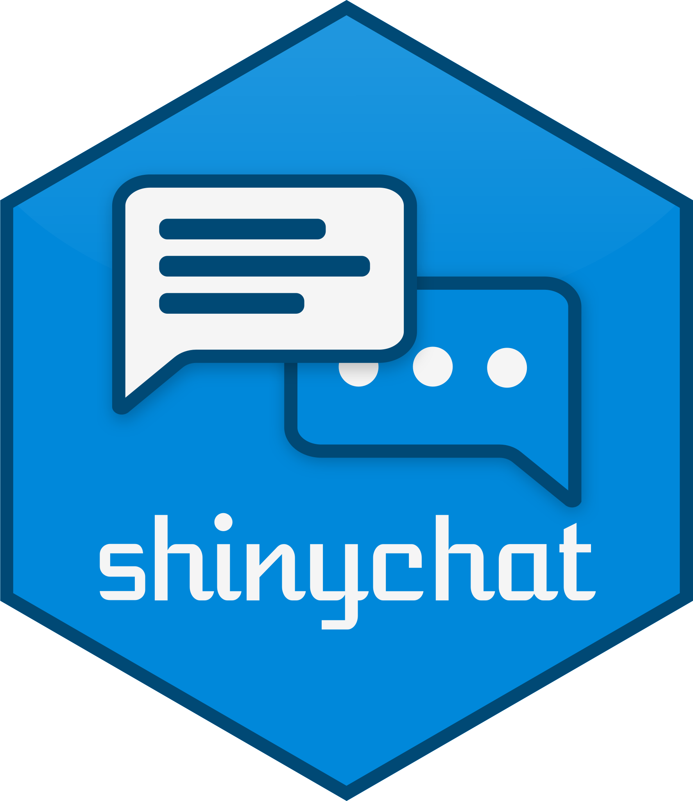

<a href="https://posit-dev.github.io/shinychat/py"></a>

<!-- badges: start -->
<!-- badges: end -->

**shinychat** provides a [Shiny](https://shiny.posit.co/py) toolkit for building generative AI applications like chatbots and streaming content. It works best with [chatlas](https://posit-dev.github.io/chatlas/), but also works great with other LLM frameworks such as LangChain, Pydantic AI, and more.

## Installation

shinychat is a dependency of the [shiny](https://pypi.org/project/shiny) package, so in most cases, you'll want to just install shiny with:

```bash
uv pip install shiny
```

However, you can also install shinychat separately with:

```bash
uv pip install shinychat
```

Or, install the development version of shinychat from [GitHub](https://github.com/posit-dev/shinychat) with:

```bash
uv pip install git+https://github.com/posit-dev/shinychat.git
```

## Quick start

The fastest way to build a chatbot with shinychat is to pass a [chatlas](https://posit-dev.github.io/chatlas/) client to `Chat(client=)`. This gives you streaming, file attachments, bookmarking, cancellation, and more out of the box — no manual wiring required.

**Shiny Express**

```{.python file="app.py"}
from chatlas import ChatAnthropic
from shiny.express import app_opts, ui
from shinychat.express import Chat

client = ChatAnthropic(system_prompt="You are a helpful assistant.")
chat = Chat(id="chat", client=client)
chat.ui()

ui.page_opts(fillable=True)
app_opts(bookmark_store="url")
```

**Shiny Core**

```{.python file="app.py"}
from shiny import App, ui
from chatlas import ChatAnthropic
from shinychat import Chat, chat_ui

app_ui = ui.page_fillable(
    chat_ui("chat"),
)

def server(input, output, session):
    client = ChatAnthropic(system_prompt="You are a helpful assistant.")
    chat = Chat("chat", client=client)

app = App(app_ui, server, bookmark_store="url")
```

The `chat.client` property provides a `.set()` method for swapping models mid-session and `.clear()` for resetting the conversation. For lower-level chat methods such as appending messages, updating the input, or inspecting stream state, call them directly on `chat`. See the [API reference](api/index.qmd) for the full interface.

## Full-page chat

Use `page_chat()` when chat is the application's primary surface. It provides a
full-window chat home, navigation pages, responsive sidebars, and an artifact
region while keeping the chat mounted as users move between pages. See
[Page chat](page-chat.qmd) for Core and Express examples, migration guidance,
and composition boundaries.

## Application state and conversation branches

If a chat changes a filter, editing a message should not leave the filter showing
a different region from the conversation. Capture that application state with
`on_save` and restore it with `on_restore`. `on_restore` runs whenever a
conversation's selected position is recreated or changed, so there is no
separate hook for branch navigation. `on_save` captures only at conversation
checkpoints, so browsing a branch never overwrites its saved state.

This complete app lets a model select regions through a tool. Set
`OPENAI_API_KEY` in the app's environment before running it. The reactive value
holds the server's filter immediately; `ui.update_text()` updates the visible
input asynchronously. Read the text input only when the user clicks Apply, so a
later browser echo cannot overwrite state restored by the callback.

```{.python file="app.py"}
from chatlas import ChatOpenAI
from shiny import App, reactive, render, ui
from shinychat import Chat, chat_ui
from shinychat.types import HistoryOptions

app_ui = ui.page_fillable(
    ui.input_text("region", "Region filter", value="all"),
    ui.input_action_button("apply_region", "Apply region"),
    ui.output_text("selected_region"),
    chat_ui("chat"),
)


def server(input, output, session):
    selected = reactive.Value("all")
    client = ChatOpenAI(
        system_prompt="Use select_region when asked to choose a region."
    )
    chat = Chat(
        "chat", client=client, history=HistoryOptions(store="file", title=None)
    )

    def sync_region(region):
        selected.set(region)
        ui.update_text("region", value=region)

    @reactive.effect
    @reactive.event(input.apply_region, ignore_init=True)
    def apply_region_input():
        sync_region(input.region())

    @chat.history.on_save
    def save_region(values):
        values["region"] = selected.get()

    @chat.history.on_restore
    def restore_region(values):
        sync_region(values.get("region", "all"))

    def select_region(region: str) -> str:
        """Select the region used to filter the app's data."""
        sync_region(region)
        return f"Selected {region}"

    client.register_tool(select_region)

    @render.text
    def selected_region():
        return selected.get()


app = App(app_ui, server)
```

Ask the model to select `west`. Accepting the input records the app state at
that moment (`region: all`) on the starting checkpoint; the tool call then
sets the filter, and when the response completes, `on_save` records `west` on
that exchange. Then edit that message to ask for `east`. Before the
replacement response starts, `on_restore` receives the starting checkpoint's
values (`region: all`), so the filter matches the position the
replacement continues from. The replacement's tool call selects `east`, and
when it completes, `on_save` records `east` on the new exchange. The `west`
exchange keeps `west`.

Editing or retrying the first message restores the values recorded on the
starting checkpoint: the first accepted input captured app state there, so
callbacks normally receive those values. A failed starting capture preserves
any previously saved root values; without recorded values, callbacks receive
`{}`. An explicit save at the root can replace its values. Your callback decides whether
to supply defaults or raise an error; history does not automatically reset
application state. An unhandled ordinary error retains the original branch
read-only. For writable in-session browsing and resubmits, the model is already
rewound when the callback runs, but `chat.messages()` and the display still
show the outgoing branch. The resubmit parent pointer commits only after the
callback succeeds. Load and conversation switch replay the target display
before invoking callbacks.

Use the sibling arrows to return to `west`. `on_restore` receives `west`. A
follow-up from `west` records its own values on its new exchange and leaves the
`east` branch unchanged. Reloading the page restores the selected position the
same way.

`on_save` runs at these checkpoints:

- When the first message is accepted, for the conversation's starting
  checkpoint, together with the paired model state. No automatic capture
  happens at startup before any input.
- When a later message is accepted, for the new exchange.
- When a response completes, after it settles. This includes cancellation and
  errors.
- For the replacement exchange created by edit, retry, or regenerate.
- When your app calls `await chat.history.save()`, for the selected position.

`on_restore` runs when a conversation's selected position is recreated or
changed:

- On page load or bookmark restore, and when switching to another conversation.
- When browsing to another position or sibling branch.
- Before the replacement response starts for edit, retry, or regenerate. It
  receives the parent's values.

`on_restore` does not run when a message is accepted or a response completes.

Starting a new chat, renaming a conversation, and persisting the selected
position pointer, when that persistence doesn't recreate or change the position,
run neither hook.

`on_save` does not capture the outgoing app state when you browse to another
position, switch conversations, or start a new chat.

Callbacks run in registration order. Values use Pydantic's JSON encoding (for
example, dates become strings and tuples become arrays). Serializer-supported
keys become strings: `1` becomes `"1"` and `None` becomes `"None"`. Restored
values use that JSON representation, not the original Python key types. If
keys normalize to the same string, the later dictionary entry wins; authors
must account for that conversion. Non-finite floating-point values are
rejected. Unchanged values inherit from the parent exchange; an empty dict
explicitly clears the saved object. Automatic capture
failures warn the developer and retain prior values; an explicit
`await chat.history.save()` raises the error.

If an `on_restore` callback raises an ordinary exception, the conversation stays
visible but becomes read-only. The composer explains that its saved application
state couldn't be restored. Callbacks registered after the failing one don't run
for that restore, and the warning includes the error. The conversation's saved
values aren't overwritten while it is read-only. The failure also stops an edit,
retry, or regenerate before its replacement response starts. Nothing retries
automatically. Selecting the already active conversation again doesn't retry its
callbacks. Switching to another conversation and back runs a full restore, and
that restore's result reclassifies the conversation under the existing read-only
rules. Use New chat to leave the conversation. If your callback can recover, handle the
case inside the callback and establish valid state before returning.

### Response checkpoints and interrupted conversations

History captures SDK turns and the system prompt when a streamed response ends,
whether it completes, errors, or is cancelled. If the app registers `on_save`
callbacks, that position remains a candidate until the existing post-reactive-flush
response settlement captures and validates the app values. These callbacks do not
run at stream end inside the still-running task, so they can read
`chat.latest_message_stream.result()` at settlement. An unchanged value is a
successful capture; no callbacks means no additional app-values requirement.

A model capture failure makes the new position invalid and propagates the error.
An automatic app capture failure warns the developer, retains prior recoverable
values, and makes the new position invalid; it does not report a successful
response save. Later app-only success cannot repair a failed model capture.
Earlier valid checkpoints remain available. Provider outcome and checkpoint
validity are separate: a cancelled or errored response can still be a valid
checkpoint when all required state was captured reliably. A store-write error
with reliable state is a durability failure, not a state-capture failure.

History does not save streamed display fragments between terminal boundaries.
A hard process crash can therefore lose the unfinished question and answer.
For a source-isolated restored viewer, history projects paths to coherent
checkpoints and keeps the ancestor input/state needed to resolve sparse values,
prompts, and legacy turn deltas. It retains ended ancestor answers on paths to
valid descendants, whose full SDK prefixes include that observed history; this
does not make those ancestors valid checkpoint destinations. Pending response
fragments and branches with no valid destination are excluded from the isolated
view and its sibling controls. Writable and ordinary model-unavailable restores
retain the full tree and recoverable state, while checkpoint eligibility filters
navigation. Restore never invents model turns from displayed text.

If the saved active position is a candidate or invalid, the restored session is
an isolated read-only viewer. It cannot save or rename that source conversation.
An empty fresh root is a writable starting position, but a failed root response
does not become a writable empty draft when its display is filtered out.
Choose **New chat** to continue chatting. Reloading does not necessarily cancel
the original response task: it may still finish and save its terminal checkpoint,
but the restored viewer does not reconnect to it or live-update. Completed
conversations still use last-writer-wins storage; this does not provide general
multi-tab ownership or conflict protection.

SDK state is captured at response end; app values are captured at settlement.
App code that mutates the SDK client between these boundaries can therefore pair
terminal-time model state with settlement-time app values. History neither detects
nor fences such mutations, and SDK calls made outside `Chat` are not tracked.
If newer input or an independent response supersedes an ended candidate before
settlement, that older position is invalidated rather than paired with the newer
response's app values. Only the latest eligible active position can settle.

Custom stores may see the nullable `ExchangeNode.checkpoint` field in schema 2:
`candidate`, `valid`, or `invalid`. `checkpoint_state` centralizes the fallback for
records without the field (or with `null`): terminal nodes are assumed valid,
pending nodes are candidates, except for an empty starting root. This preserves
older v2 records; it cannot retrospectively identify their unrecorded capture
failures. New records classify positions explicitly. Schema 2 is still unreleased,
so this additive field does not introduce a new schema version.

Coherent checkpoints save model turns as exact-prefix deltas: the capture compares the
client's current serialized turn list with the checkpoint's parent on its branch and stores
only the added turns when the parent's saved context is an exact prefix. When there is no
usable baseline — the conversation's starting checkpoint — or the context was rewritten
(compaction, truncation, or any changed earlier turn), the checkpoint stores one full
snapshot instead. An unchanged context is not copied again. This keeps stored model state
growing linearly, rather than quadratically, as an append-only conversation gets longer.
Restore is exact and unchanged for reloads, conversation switching, browsing, edits,
retries, and regenerations, and existing full-snapshot records remain readable; no schema
version is introduced. System prompts and app values keep their separate sparse capture
rules, so a prompt-only change does not force a full turn snapshot.

Full snapshots remain necessary for starting contexts, rewrites, and preserving existing
branches when a shared parent is recaptured. A conversation's complete record also keeps a copy of each exchange's
displayed messages for replay, which this policy does not deduplicate — so complete
record files shrink less than the turn payloads do. The file store's `max_store_mb` budget
still applies (100 MB by default); this change does not increase the quota or change its
defaults.

Leaving a coherent completed position or disconnecting captures the latest model
state without invoking app-state `on_save` callbacks. Explicit `history.save()`
continues to capture app state at coherent positions.

## Slash commands

Slash commands give users discoverable shortcuts — like `/search`, `/clear`, or `/help` — that run a server-side handler you define. Register a command with `@chat.slash_command(name, description)`. When a user runs it, the matching handler fires *instead* of `@chat.on_user_submit`, and what happens next is entirely up to the handler.

The two most common patterns are **prompt expansion** — where the command transforms the user's input before sending it to the LLM — and **side effects** — where the command performs an action without involving the LLM at all.

### Prompt expansion

The most common use of slash commands is giving users a shortcut that sends a prompt to the model on their behalf. A handler taking one argument receives the text typed after the command name — for `/search shiny modules`, that's `"shiny modules"`.

For example, a `/search` command could enrich the user's query with retrieved context before streaming the model's answer. In a real app the retrieval step would query a vector store or search index (i.e., a RAG workflow), but the core pattern is the same:

```{.python file="app.py"}
from chatlas import ChatAnthropic
from shiny.express import app_opts, ui
from shinychat.express import Chat

client = ChatAnthropic(system_prompt="You are a helpful assistant.")
chat = Chat(id="chat", client=client)
chat.ui(placeholder="Type / for commands, or chat away...")

@chat.slash_command("search", "Search the docs")
async def _(user_input: str):
    # In practice, retrieve relevant documents here (e.g., via a vector DB)
    prompt = f"Search the documentation for the following topic and provide a concise summary: {user_input}"
    response = await chat.client.value.stream_async(prompt, content="all")
    await chat.append_message_stream(response)

ui.page_opts(fillable=True)
app_opts(bookmark_store="url")
```

When the user types `/search shiny modules`, the handler expands the input into a richer prompt and streams the model's response. The user sees `/search shiny modules` as their message; the LLM receives the expanded prompt. In Shiny Core, register commands inside your server function in exactly the same way (`slash_command` is a method on `Chat`).

### Side effects

Some commands perform an action without involving the LLM — clearing the conversation, opening a help modal, exporting a transcript. Pass `echo=False` so the command doesn't appear as a user message:

```python
@chat.slash_command("clear", "Clear the conversation", echo=False)
async def _():
    await chat.client.new_chat()
```

With conversation history enabled (the default for client-backed chats), `new_chat()` is the coordinated reset: it saves the current conversation and starts a fresh one. For a chat without history, use `await chat.clear_messages()` instead; it clears only the rendered messages and is rejected while history is enabled.

### Client-side handlers

Register a command with `fn=None` so it appears in the palette without a server handler, then handle it in the browser via the `shiny:chat-slash-command` DOM event:

```{.python file="app.py"}
from shiny.express import ui
from shinychat.express import Chat

chat = Chat("chat")
chat.ui()

chat.slash_command("clear", "Clear the input", fn=None)

ui.tags.script(
    """
    document.addEventListener('shiny:chat-slash-command', (e) => {
      if (e.detail.id !== 'chat' || e.detail.command !== 'clear') return;
      e.preventDefault();
      document.querySelector('#chat textarea').value = '';
    });
    """
)
```

The event is cancelable and bubbles. Use `e.detail.id` to target a specific chat. `preventDefault()` skips the server round-trip; set `e.detail.echo` to control whether the command appears as a user message.

### Key points

- Users type `/` to open a palette of registered commands; arrow keys navigate, Enter or Tab selects, Escape dismisses.
- A slash command's handler fires instead of `@chat.on_user_submit`. What happens next — including whether anything reaches the LLM — is entirely up to your handler.
- A `/` message that doesn't match any registered command is sent as an ordinary message.
- Handlers take 0 or 1 argument (the text after the command name). They're just app code — they can stream LLM responses, show modals, trigger downloads, or do nothing visible at all.
- The `echo` argument controls whether invoking the command appears as a user message. Defaults to `True` with a handler. Pass `echo=False` for side-effect-only handlers.
- Registering returns a function that removes the command when called; you can also call `chat.remove_slash_command(name)`. Re-registering an existing name raises an error unless you pass `force=True`.
- Slash command messages are restored faithfully when a bookmarked app is reopened.

## Lower-level interface

When you need full control over the server-side logic — or you're using an LLM framework other than chatlas — omit the `client=` argument and wire things up manually. This means handling streaming, file attachments, bookmarking, and cancellation yourself, but gives you complete flexibility over how messages are generated and displayed.

**Shiny Express**

```{.python file="app.py"}
from shiny import reactive
from shiny.express import input
from chatlas import ChatAnthropic, StreamController
from shinychat.express import Chat

chat = Chat(id="chat")
chat.ui(enable_cancel=True)

client = ChatAnthropic(system_prompt="You are a helpful assistant.")
ctrl = StreamController()

@chat.on_user_submit
async def handle_user_input(user_input: str):
    response = await client.stream_async(user_input, controller=ctrl)
    await chat.append_message_stream(response)

@reactive.effect
@reactive.event(input.chat_cancel)
def handle_cancel():
    ctrl.cancel()
```

**Shiny Core**

```{.python file="app.py"}
from shiny import App, reactive, ui
from chatlas import ChatAnthropic, StreamController
from shinychat import Chat, chat_ui

app_ui = ui.page_fillable(
    chat_ui("chat", enable_cancel=True),
)

def server(input, output, session):
    client = ChatAnthropic(system_prompt="You are a helpful assistant.")
    chat = Chat("chat")
    ctrl = StreamController()

    @chat.on_user_submit
    async def handle_user_input(user_input: str):
        response = await client.stream_async(user_input, controller=ctrl)
        await chat.append_message_stream(response)

    @reactive.effect
    @reactive.event(input.chat_cancel)
    def handle_cancel():
        ctrl.cancel()

app = App(app_ui, server)
```

Key points:

- `enable_cancel=True` shows the stop button while a response is streaming.
- `StreamController()` is created once and reused — it automatically resets between streams.
- Pass the controller to `stream_async(controller=ctrl)` so chatlas can honour the cancellation signal.
- The cancel input fires as `input.<id>_cancel` (e.g. `input.chat_cancel`). Observe it with `@reactive.event` to call `ctrl.cancel()`. This is needed in both Express and Core apps.
- chatlas retains the partial response in live client history on cancellation. Persistent history offers a response as a valid checkpoint only after it ends and model capture, any registered app-state capture, and storage succeed. A hard kill can lose the unfinished exchange. After reload, the original task may still finish and save, but the restored viewer does not automatically adopt its display or client context.
- Starting a second stream, or appending a complete message, while a stream is active raises `RuntimeError`. Use the stream's status to sequence follow-up work. See the [migration guide](migrating-to-0.8.0.qmd).

## File attachments

shinychat supports file attachments, allowing users to upload images, PDFs, and text files alongside their messages. When attachments are enabled, the chat input shows a file picker button and also accepts drag-and-drop or clipboard paste.

### Using `client=` (recommended)

When you pass a chatlas client to `Chat(client=)`, file attachments are enabled automatically. The attachment button appears in the chat input, and uploaded files are converted to the appropriate chatlas content types and sent to the model — no extra code needed.

### Manual approach

If you're wiring things up manually, enable attachments in the UI and accept them in your submit handler.

**Shiny Express**

```{.python file="app.py"}
from chatlas import ChatAnthropic
from shinychat.express import Chat
from shinychat import Attachment, attachment_to_content

chat = Chat(id="chat")
chat.ui(allow_attachments=True)

client = ChatAnthropic(system_prompt="You are a helpful assistant.")

@chat.on_user_submit
async def handle_user_input(user_input: str, attachments: list[Attachment]):
    contents = [attachment_to_content(a) for a in attachments]
    response = await client.stream_async(user_input, *contents)
    await chat.append_message_stream(response)
```

**Shiny Core**

```{.python file="app.py"}
from shiny import App, ui
from chatlas import ChatAnthropic
from shinychat import Chat, chat_ui, Attachment, attachment_to_content

app_ui = ui.page_fillable(
    chat_ui("chat", allow_attachments=True),
)

def server(input, output, session):
    client = ChatAnthropic(system_prompt="You are a helpful assistant.")
    chat = Chat("chat")

    @chat.on_user_submit
    async def handle_user_input(user_input: str, attachments: list[Attachment]):
        contents = [attachment_to_content(a) for a in attachments]
        response = await client.stream_async(user_input, *contents)
        await chat.append_message_stream(response)

app = App(app_ui, server)
```

Key points:

- Pass `allow_attachments=True` to `chat_ui()` to show the file picker button. You can also pass a list of MIME types (e.g. `["image/png", "image/jpeg"]`) to restrict accepted file types.
- Declare two parameters on your `@chat.on_user_submit` handler to receive both the text and attachments. With one parameter, you only receive the text.
- Use `attachment_to_content()` to convert each `Attachment` into a chatlas content object (image, PDF, or text).
- The maximum combined attachment size defaults to approximately 30 MB and can be configured via the `SHINYCHAT_MAX_ATTACHMENT_SIZE` environment variable.

## Learn more

The official shiny website offers the best starting point for learning about shinychat:

* [Get inspired](https://shiny.posit.co/py/docs/genai-inspiration.html)
* [Chatbots](https://shiny.posit.co/py/docs/genai-chatbots.html)
* [Streaming markdown](https://shiny.posit.co/py/docs/genai-stream.html)
* [Tool calling](https://shiny.posit.co/py/docs/genai-tools.html)
* [Structured data](https://shiny.posit.co/py/docs/genai-structured-data.html)
